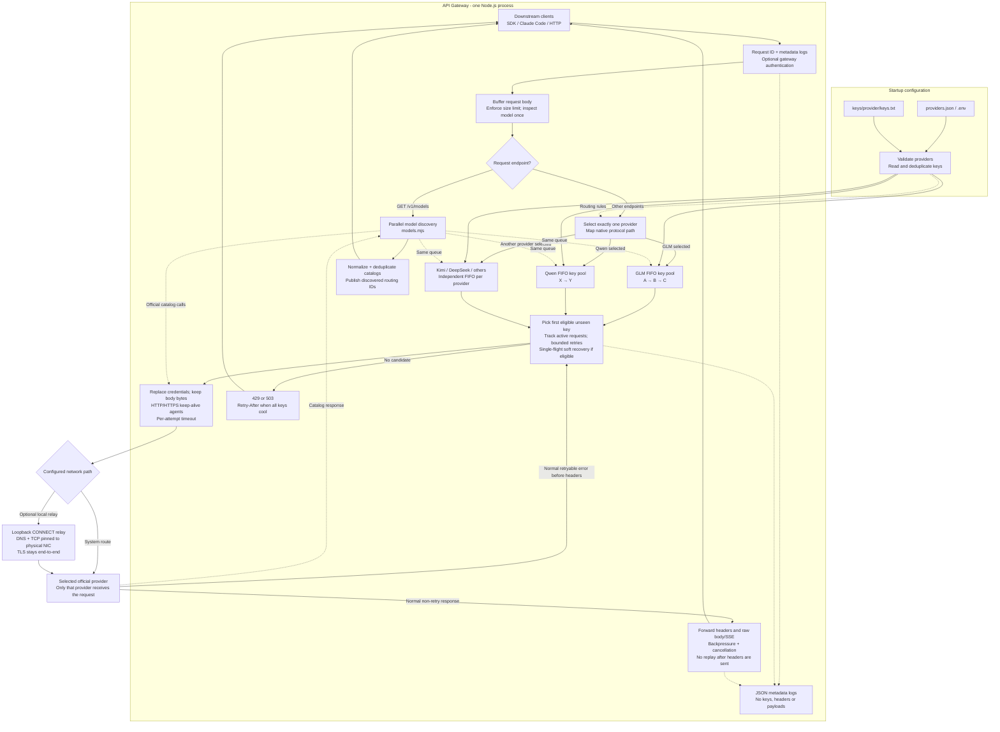
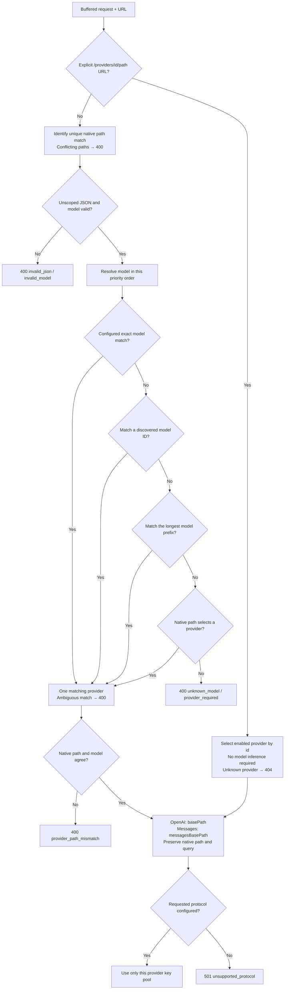
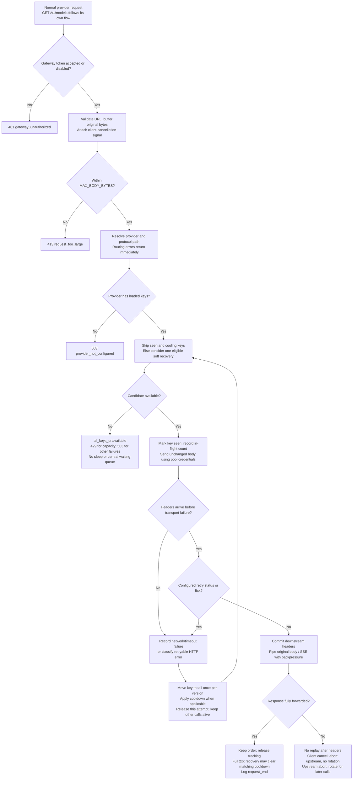
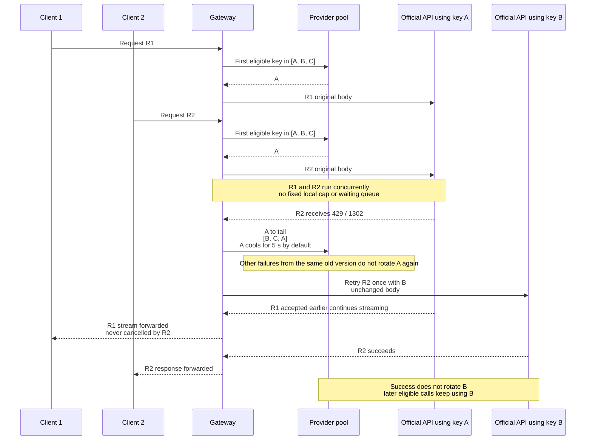
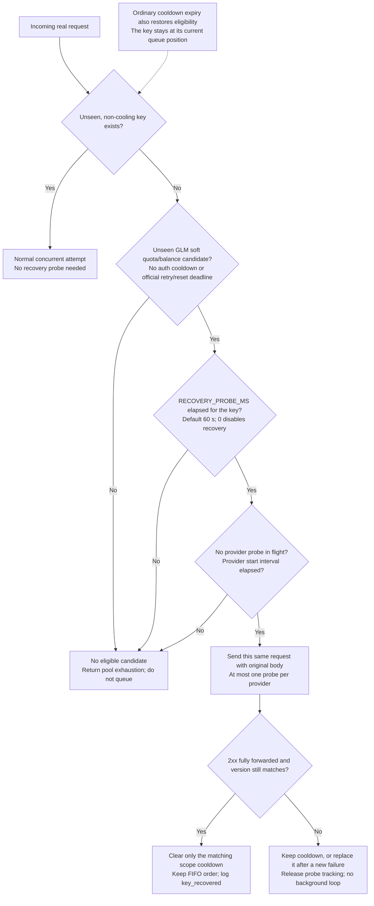
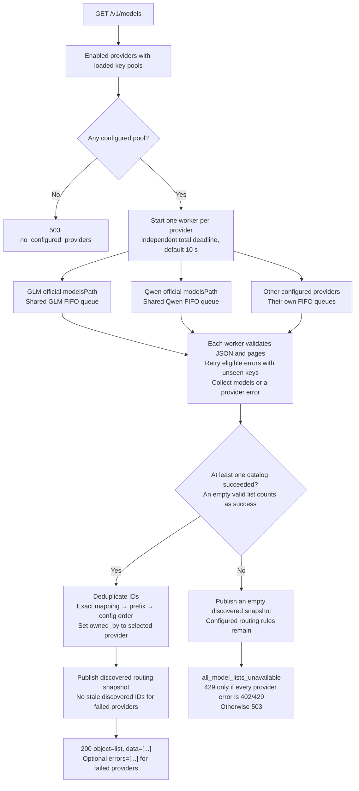
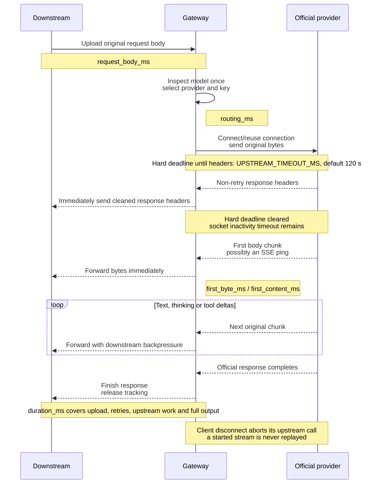
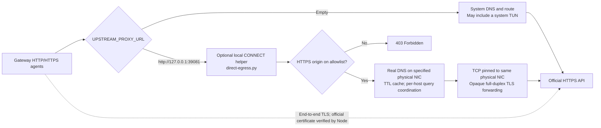

<h1 align="center">API Gateway</h1>

<p align="center">Model-based routing · Independent key pools · Concurrent transparent streaming</p>
<p align="center"><strong>English</strong> · <a href="README.zh-CN.md">简体中文</a></p>

A lightweight gateway for official model APIs. Change the base URL, keep the official request format, and let each provider's ordered key pool handle failures and cooldowns.

## Contents

- [Features](#features)
- [Quick start](#quick-start)
- [Architecture](#architecture)
- [Client usage](#client-usage)
- [Routing decisions](#routing-decisions)
- [Complete request lifecycle](#complete-request-lifecycle)
- [FIFO and concurrent traffic](#fifo-and-concurrent-traffic)
- [Retries, cooldowns and recovery](#retries-cooldowns-and-recovery)
- [Live model discovery](#live-model-discovery)
- [Streaming and timeouts](#streaming-and-timeouts)
- [Logs and latency metrics](#logs-and-latency-metrics)
- [Configuration](#configuration)
- [Deployment and network access](#deployment-and-network-access)
- [Optional physical-interface egress](#optional-physical-interface-egress)
- [Limits and troubleshooting](#limits-and-troubleshooting)
- [Tests](#tests)

## Features

- Model routing for GLM, Qwen, Kimi, DeepSeek, MiniMax, OpenAI, Anthropic, Gemini, Doubao and StepFun.
- Independent FIFO key pools: keep using the first eligible key; rotate on failure. No load balancing or cross-provider fallback.
- Concurrent forwarding without a fixed per-key cap or a central waiting queue.
- OpenAI and Anthropic Messages requests routed to provider-native endpoints; bodies, model names, tool calls and SSE bytes preserved.
- Live official model discovery; scoped cooldowns and controlled recovery using real requests.
- Metadata-only JSON logs and keep-alive connections. Node.js built-ins only; the optional Linux egress helper uses Python 3's standard library.

## Quick start

Requires **Node.js 22.21+**; on Node.js 24, use **24.5+** for native proxy support.

```bash
git clone git@github.com:LMDHQ-0420/api-gateway.git
cd api-gateway
npm run init-keys
```

Add keys to the relevant files, one key per line. Initialization preserves existing files. Blank lines and `#` comments are ignored; duplicates are removed within each pool.

```text
keys/
├── glm/keys.txt
├── qwen/keys.txt
├── kimi/keys.txt
└── <provider>/keys.txt
```

```bash
npm start
```

Default address: `http://127.0.0.1:3000`. Optional overrides go in `.env`, copied from `.env.example`. Missing or empty key files leave that provider unconfigured without blocking others, except for the optional legacy GLM fallback. Restart after changing keys or configuration. `keys/`, `.env` and legacy key files are Git-ignored; custom private config/key locations also need an ignore rule.

## Architecture



Solid arrows show the main request/control flow; dotted arrows show configuration, shared state, metadata or helper calls. The provider branches are alternatives: **one normal request selects exactly one provider**. Catalog discovery is the separate, explicitly parallel path.

| Component | Responsibility |
| --- | --- |
| [server.mjs](server.mjs) | Ingress/auth, body buffering, key queues, transport, retry loop, streaming and cancellation |
| [routing.mjs](routing.mjs) | Provider validation/loading, model inspection, provider selection and native path mapping |
| [attempts.mjs](attempts.mjs) | In-flight tracking and single-flight recovery; ordinary calls are neither capped nor queued |
| [retry.mjs](retry.mjs) | Bounded GLM error inspection, official-code classification and reset/Retry-After parsing |
| [models.mjs](models.mjs) | Parallel official catalog queries, pagination, deduplication and discovered routing snapshots |
| [transport.mjs](transport.mjs) | Dedicated HTTP/HTTPS keep-alive agents and explicit optional egress |
| [observe.mjs](observe.mjs) | Raw-byte response observer; first-byte/content timing without payload logs |
| [scripts/direct-egress.py](scripts/direct-egress.py) | Optional Linux physical-interface DNS/TCP relay; no TLS decryption or key access |

## Client usage

For an OpenAI-compatible client, set `base_url` to `http://127.0.0.1:3000/v1`. Keep the official request format and choose a real provider model ID:

```bash
curl -N http://127.0.0.1:3000/v1/chat/completions \
  -H 'Authorization: Bearer YOUR_CLIENT_KEY' \
  -H 'Content-Type: application/json' \
  -d '{"model":"qwen-plus","messages":[{"role":"user","content":"Hello"}],"stream":true}'
```

Without `GATEWAY_TOKEN`, clients may keep their existing key parameter. With it enabled, use that gateway token via `Authorization: Bearer <token>` or Claude-compatible `x-api-key`. The gateway always replaces upstream credentials with the selected official pool key, and strips client cookies and alternate authentication headers. Transparency covers payloads and native protocol behavior, not authentication, hop-by-hop headers, aggregate catalogs or gateway-generated errors.

| Endpoint | Behavior |
| --- | --- |
| `/v1/chat/completions` | OpenAI-format request; select provider by model |
| `/v1/messages` | Claude Code / Anthropic request; map to official Messages path |
| `/v1/messages/count_tokens` | Official counting endpoint, if supported by the selected provider |
| `GET /v1/models` | Aggregate live official catalogs; see the discovery flow |
| `/api/paas/v4/...`, `/api/coding/paas/v4/...` | Recognize GLM native paths |
| `/providers/<id>/<official-path>` | Explicit provider selection, including requests without model |

For example, `/providers/kimi/v1/files` forwards to Kimi's `/v1/files`. Scoped URLs also support binary/multipart payloads within `MAX_BODY_BYTES`; they do not require model inference. Other endpoints are passed to the configured official service and must be supported there.

### Claude Code

Use the gateway origin **without appending `/v1`**:

```bash
export ANTHROPIC_BASE_URL=http://127.0.0.1:3000
export ANTHROPIC_AUTH_TOKEN=gateway
export ANTHROPIC_MODEL=glm-5.3
export ANTHROPIC_DEFAULT_OPUS_MODEL=glm-5.3
export ANTHROPIC_DEFAULT_SONNET_MODEL=glm-5.3
export ANTHROPIC_DEFAULT_HAIKU_MODEL=glm-5.3
claude
```

Replace `gateway` with `GATEWAY_TOKEN` when enabled. Model IDs in examples are request examples, not access or quota guarantees; select IDs supported by your account/endpoint. The gateway does not rename Claude aliases. An explicit base URL such as `http://127.0.0.1:3000/providers/glm` also works.

| Provider | Configured Messages prefix |
| --- | --- |
| GLM | `/api/anthropic/v1` |
| Qwen | `/apps/anthropic/v1` |
| Kimi API / DeepSeek / MiniMax | `/anthropic/v1` |
| Anthropic / StepFun | `/v1` |
| Doubao | `/api/compatible/v1` |

These paths come from [providers.json](providers.json). Match origins and paths to your region and plan; a subscription key may require a different endpoint. Kimi Code needs its own compatible origin/path configuration. Providers without `messagesBasePath`, such as the shipped OpenAI/Gemini entries, return `501 unsupported_protocol` for Messages. There is no OpenAI-to-Anthropic body conversion; catalog-listed image/audio models are not automatically usable with Claude Code.

## Routing decisions



Exact model IDs take priority over discovered IDs, then the longest configured prefix. Conflicting matches fail instead of silently selecting a provider. Native path/model mismatches fail; explicit provider URLs deliberately pin the provider. Queries and body model names are preserved. A configured model is a routing rule, not a fabricated `/v1/models` entry or a declaration of current availability.

## Complete request lifecycle



1. Validate the gateway token and origin-form URL; enforce the body limit while buffering the original bytes.
2. Inspect JSON model metadata once, resolve the provider and protocol path, and create a request-local `seen` set.
3. Select the first eligible unseen key. Only if none exists, check controlled soft recovery eligibility.
4. Replace credentials and send the exact body through the official connection. Record the attempt before sending; ordinary requests do not wait for a local slot.
5. Retry eligible failures with another unseen key. Fully forward every other response, including non-retryable 4xx errors.
6. Once downstream headers are committed, stop retrying. Complete or cancel the response, release tracking, and write one final request record.

Gateway-generated routing/auth/configuration failures return immediately. Each normal request tries each key in its selected provider pool at most once; retries may still duplicate work already accepted upstream. There is no cross-provider fallback and no model rewriting.

## FIFO and concurrent traffic



A **key queue orders credentials, not downstream requests**. Many concurrent calls may use the same healthy head. `in_flight` measures activity in this gateway; it neither sets nor reveals the official account's concurrency limit. Usage by other applications sharing an account is invisible here.

| Event | Queue effect |
| --- | --- |
| A succeeds in `[A, B, C]` | Keep `[A, B, C]`; continue using A |
| A fails with a retryable error | Move to `[B, C, A]`; skip A while its matching cooldown applies |
| A's cooldown expires | A becomes eligible at its current position; it is not promoted to the head |
| Another call reports the same old failure version | Do not rotate again or extend the newer cooldown |
| Client cancels | Abort only its upstream call; do not blame or rotate the key |
| Qwen key fails | GLM/Kimi queues are unaffected |

More configured keys do not imply more usable capacity: keys can lack quota, share the same account, or be used externally. Successful short probes and successful token counting do not establish sustained generation capacity.

## Retries, cooldowns and recovery

### Default error handling

| Condition before downstream headers | Handling | Default cooldown |
| --- | --- | --- |
| `401` | Rotate and retry | 5 min, global to the key |
| `402` or unclassified `429` | Rotate and retry | 30 s, scoped |
| GLM `429 / 1302` | Rotate and retry | 5 s, scoped |
| GLM `429 / 1308` or `1310` | Rotate and retry | Valid official reset time, otherwise 15 min |
| GLM `429 / 1113` | Rotate and retry | 1 h, scoped |
| `403`, `408`, `5xx` | Rotate and retry | No additional default cooldown |
| Connection failure or timeout | Rotate and retry | No additional default cooldown |
| Other HTTP statuses, including `400`, `404`, `422` | Pass original response through | No rotation |

`retryStatuses` can customize status-based retries per provider; `5xx` remains retryable. Scoped cooldowns use **protocol + official endpoint path without query + model**. Authentication cooldown is global to that key. Generation, `count_tokens`, OpenAI and model discovery can therefore have different eligibility on the same credential.

GLM error inspection is limited to HTTP 429, 64 KiB and 250 ms; decoded errors have the same size limit. Unknown/unsupported/oversized errors use generic handling. Reset times must be explicit `next_flush_time`/`reset_at` fields or reset-labeled timestamps, in the future and no more than 7 days away; timezone-less Chinese GLM timestamps use UTC+08:00. Official `Retry-After` may extend cooling, with its extension capped at one hour. A zero base/auth cooldown disables the corresponding cooling rule.

### Controlled recovery



Recovery is **request-driven, not a scheduled health checker**. `RECOVERY_PROBE_MS` defaults to 60 s. Each provider permits one recovery attempt in flight and spaces starts by `min(15000, RECOVERY_PROBE_MS)` milliseconds; each key must also satisfy its own interval. No background inference is generated. Only GLM quota/balance failures without an explicit official retry/reset deadline qualify. `401`, short rate cooldowns and explicit deadlines do not qualify for early probing.

Only a fully forwarded 2xx with the matching failure version clears that scope. Failed/cancelled/interrupted/non-2xx attempts do not recover the key; a new failure may update its cooldown. Normal cooldown expiry works independently. HTTP 2xx still does not prove response-body business success.

### Pool exhaustion

`all_keys_unavailable` includes provider, actual attempt count and failure indexes; optional `cooling_keys` includes skipped indexes, statuses and remaining cooldown milliseconds, never full keys.

| Normal-request failure mix | Gateway status |
| --- | --- |
| Ignoring `401`, at least one failure remains and all remaining statuses are `402`/`429` | `429` |
| All failures are `401`, or other server/transport failures are present | `503` |

If every key is currently cooling, include `Retry-After`. For capacity exhaustion, derive it from the earliest non-auth cooldown; otherwise use the earliest cooldown. If no recovery attempt is currently eligible, return immediately rather than sleeping or queuing. The client decides whether/when to retry.

## Live model discovery



Every aggregate request queries official APIs again; there is no cached response or static model fallback. The per-provider deadline covers connection setup, all key retries, body reads and pages. Each page is limited to 4 MiB before/after decompression, with at most 100 pages; Anthropic-style `has_more`/`last_id` pagination is supported.

Catalog workers use `KeyQueue.next(..., "models")` directly and share queue ordering/auth cooldowns with inference. They do **not** use `Attempts` recovery probing or ordinary-request in-flight tracking. Aggregate all-failed status uses provider error statuses: all must be 402/429 for a 429; otherwise 503. This is separate from normal-request mixed-auth exhaustion classification.

An explicit model mapping is authoritative: if its canonical provider did not list the ID successfully, the gateway does not substitute another provider's copy. Otherwise the longest matching prefix wins, then configuration order. Empty successful lists are valid. IDs are compared case-insensitively for deduplication; original returned IDs are retained. Failed providers go into `errors`, not `data`; failed providers' previous discovered IDs are cleared when publishing the new snapshot. Configured exact/prefix rules remain.

A successful list query establishes only catalog access, **not generation quota, endpoint compatibility or sustained capacity**. Provider-specific list URLs use normal transparent forwarding and return the official body, rather than aggregation.

## Streaming and timeouts



The hard response-header deadline defaults to 120 s **per attempt**, including DNS, connect, TLS, request sending and partial response headers. After headers arrive, only socket inactivity is timed; a healthy SSE stream may run longer than 120 s in total. Retrying several keys can therefore make the full request much longer than one attempt's deadline.

The gateway immediately forwards non-retry response headers and pipes raw chunks with backpressure. It does not disable thinking, shorten context/output, rewrite models, force streaming, race inference calls or replay a committed response. It strips hop-by-hop headers and `set-cookie`; SSE receives `x-accel-buffering: no` when absent. Configure reverse proxies to avoid extra buffering. A downstream disconnect aborts that call; an upstream body interruption may rotate the key for later calls, but the current response cannot be retried safely.

## Logs and latency metrics

JSON lines go to stdout. A normal request emits `request_start` → `route_selected` → one or more `upstream_attempt`/`upstream_response` events → `request_end`. Failures add `key_rotated`; cooldowns add `cooldown_skipped`/`pool_cooldown`; first recognizable SSE content adds `first_content`; recovery adds `key_recovered`. Discovery emits provider-level results. `runtime_config` records effective process settings, including systemd overrides.

| Field | Meaning |
| --- | --- |
| `request_id` | Gateway-generated request correlation ID |
| `key_index` | Deduplicated startup index; stable across rotation, may change after file edits and restart |
| `in_flight` | That key's active normal attempts in this gateway, including response streaming; not external usage or an official limit |
| `request_bytes` / `request_body_ms` | Buffered bytes / receiving and buffering time |
| `routing_ms` | JSON inspection and provider/path selection after buffering |
| `upstream_response.response_headers_ms` | Header wait for that one attempt |
| `request_end.response_headers_ms` | Total time to final forwarded headers, including upload/routing/retries |
| `first_byte_ms` | First response-body byte; may be a ping rather than content |
| `first_content_ms` / `first_content_kind` | First recognized uncompressed SSE text, thinking or tool delta; not necessarily answer text |
| `response_bytes` / `duration_ms` | Forwarded body bytes / complete request duration |
| `transport.request_sent_ms` | Attempt time until Node finishes writing the request, not confirmation of remote processing |
| `transport.wait_after_upload_ms` | Header time minus local request-write completion; includes network and provider wait |
| Transport failure `phase` | `upload_or_connection` or `waiting_headers`; not a precise diagnosis of the cause |

Final outcomes are `success`, `http_error`, `partial_success` (aggregate catalogs), `client_disconnected` and `upstream_interrupted`. Success means HTTP forwarding completed, not that payload-level business logic succeeded. Compressed/non-SSE responses do not expose content timing. In latency reports, separate generation from `count_tokens` and catalogs; report sample windows, success denominators and unfinished requests. Fast failures can lower an average without improving service capacity.

Logs contain metadata only: no key values, auth/other headers, prompts, response bodies or query strings. Unknown path components become `:redacted`; logged model strings are capped at 200 characters. Do not put secrets in model names. For a user systemd deployment:

```bash
journalctl --user -u api-gateway.service -f -o cat
```

Use the terminal for `npm start`, or `docker logs -f api-gateway` for Docker. Journal/container logging controls retention.

## Configuration

Copy [.env.example](.env.example) to `.env`. Values below are defaults; service-manager environment variables may override them.

| Variable | Default / purpose |
| --- | --- |
| `HOST` / `PORT` | `127.0.0.1` / `3000` |
| `PROVIDERS_FILE` | `providers.json` |
| `GATEWAY_TOKEN` | Empty; optional client access token |
| `KEYS_FILE` | `keys.txt`; legacy GLM fallback when its dedicated pool is empty |
| `UPSTREAM_ORIGIN` | Unset; optional GLM origin override |
| `UPSTREAM_TIMEOUT_MS` | `120000`; per-attempt header deadline, then socket inactivity timeout |
| `UPSTREAM_KEEPALIVE_MS` | `60000`; idle connection reuse, respecting shorter official hints |
| `UPSTREAM_PROXY_URL` | Empty; system routing without inheriting other applications' proxy environment |
| `MODELS_TIMEOUT_MS` | `10000`; complete discovery deadline per provider |
| `MAX_BODY_BYTES` | `33554432` (32 MiB) |
| `KEY_COOLDOWN_MS` / `AUTH_COOLDOWN_MS` | `30000` / `300000`; `0` disables the corresponding cooling rule |
| `RATE_COOLDOWN_MS` / `QUOTA_COOLDOWN_MS` / `BALANCE_COOLDOWN_MS` | `5000` / `900000` / `3600000`; classified GLM defaults |
| `RECOVERY_PROBE_MS` | `60000`; `0` disables early soft recovery |

Provider definitions live in [providers.json](providers.json). `keysFile` is relative to that config file. Configure `id`, `origin`, `basePath`, `models`, `modelPrefixes`, and optionally `messagesBasePath`, `messagesAuth`, `modelsPath`, `nativePrefixes`, `auth`, `headers`, `retryStatuses`, and `enabled`. `models` controls exact routing, including endpoint IDs such as `ep-...`; it does not populate the live catalog. Add a provider, then run `npm run init-keys` to initialize its file. Use a separate ignored config for private endpoint overrides and point `PROVIDERS_FILE` to it.

## Deployment and network access

`npm start` loads `.env`; use a process manager such as systemd or Docker for persistence. To expose the gateway to a LAN, listen on a reachable interface (for example `HOST=0.0.0.0`) and use the server's LAN address in clients. The host firewall and any WSL/Windows forwarding must also allow the selected port; changing `HOST` alone does not establish forwarding. Example port 3000 is the project default, not a promise about a deployment's actual port.

### systemd on Linux

Create the user unit directory with `mkdir -p ~/.config/systemd/user`. Create `~/.config/systemd/user/api-gateway.service`, replacing `/absolute/path/api-gateway` and `/usr/bin/node` with your installation paths:

```ini
[Unit]
Description=API Gateway

[Service]
WorkingDirectory=/absolute/path/api-gateway
ExecStart=/usr/bin/node --env-file-if-exists=.env /absolute/path/api-gateway/server.mjs
Restart=always
RestartSec=5
TimeoutStopSec=15
UMask=0077

[Install]
WantedBy=default.target
```

```bash
systemctl --user daemon-reload
systemctl --user enable --now api-gateway.service
```

If the user service must remain active after logout, enable lingering with `loginctl enable-linger "$USER"` where permitted. Apply future key/config changes with `systemctl --user restart api-gateway.service`; restarts reset in-memory state and may interrupt long calls.

### Docker

Prepare local key files first:

```bash
docker build -t api-gateway .
docker run -d --name api-gateway --restart unless-stopped \
  -p 127.0.0.1:3000:3000 \
  --mount type=bind,src="$PWD/keys",dst=/app/keys,readonly \
  --mount type=bind,src="$PWD/providers.json",dst=/app/providers.json,readonly \
  api-gateway
```

The image excludes keys and `.env`. Mounted files must be readable by the container user; use `--user "$(id -u):$(id -g)"` if needed. For LAN publication, choose the desired host bind address instead of `127.0.0.1`. With `--env-file .env`, keep `HOST=0.0.0.0` inside the container. Configure reverse-proxy streaming and, for browser use, same-origin access or your own CORS policy.

## Optional physical-interface egress



The optional Linux helper is for deployments where system routing/TUN interferes with direct provider access. It is not required on networks where system routing works normally.

```bash
python3 scripts/direct-egress.py \
  --interface <physical-interface> \
  --dns-server <network-DNS-server> \
  --providers-file providers.json
```

Set `UPSTREAM_PROXY_URL=http://127.0.0.1:39081` and restart the gateway. The loopback-only helper reads configured HTTPS origins, never key files. DNS follows TTL with per-host lookup coordination; TCP binds the same interface and uses the system backlog for connection bursts. TLS remains end-to-end and certificates are still checked by Node. Linux must permit `SO_BINDTODEVICE`; IPv4 only. Interface/DNS changes require updated arguments. Containers need a reachable helper address rather than their own loopback; the standard Node image does not bundle Python or this optional helper. With egress unset, no local relay is used, but system-level TUN routing may still apply.

## Limits and troubleshooting

| Symptom / boundary | Interpretation |
| --- | --- |
| A key passes a short test but production gets 429 | Point-in-time success is not sustained quota/concurrency capacity; check classified errors and external account usage |
| `/v1/models` or `count_tokens` succeeds but generation fails | Different endpoint/scope; catalog/counting access is not generation capacity |
| First chunk is fast but completion is slow | Full duration includes provider thinking, tool/output generation, retries and downstream backpressure |
| Low first-byte time without `first_content_ms` | Could be SSE heartbeats, compressed data, non-SSE, or an unrecognized/empty stream |
| `all_keys_unavailable` | All unseen candidates are cooling or failed; eligible recovery may already be occupied or not due |
| Model or native-path conflict | Fix exact/prefix mappings or use `/providers/<id>` |
| More gateway processes | Each has its own FIFO/cooldown/recovery state; there is no distributed coordination |
| Restart | Keys/rules reload; in-memory order, cooldowns, discovered models and tracking reset; long calls may be interrupted |
| Uploads and account-owned resources | Body is buffered within the configured limit; files/tasks are not pinned to their originating key |
| Committed response | No safe replay after downstream headers; HTTP 200 business/SSE errors stay transparent |
| Supported transport | HTTP/SSE; no WebSocket or protocol translation |

Run a single instance if one shared ordering is required. More keys on the same account do not necessarily increase limits. This gateway routes traffic; it does not create extra provider quota or guarantee upstream availability.

## Tests

```bash
npm test
```

Tests use local mock providers, not real keys or paid inference. Linux egress tests require optional Python 3; TLS tests use temporary OpenSSL-generated certificates when available. Mermaid diagrams above render directly on GitHub.
