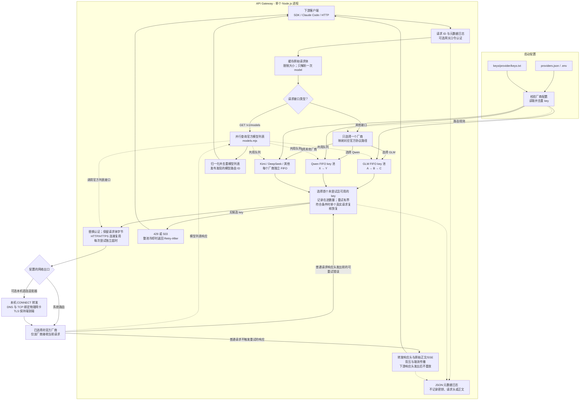
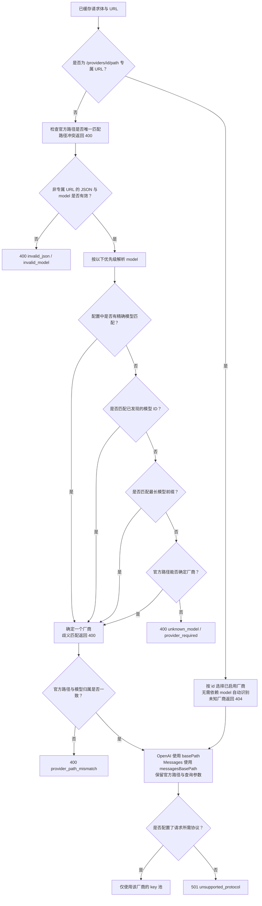
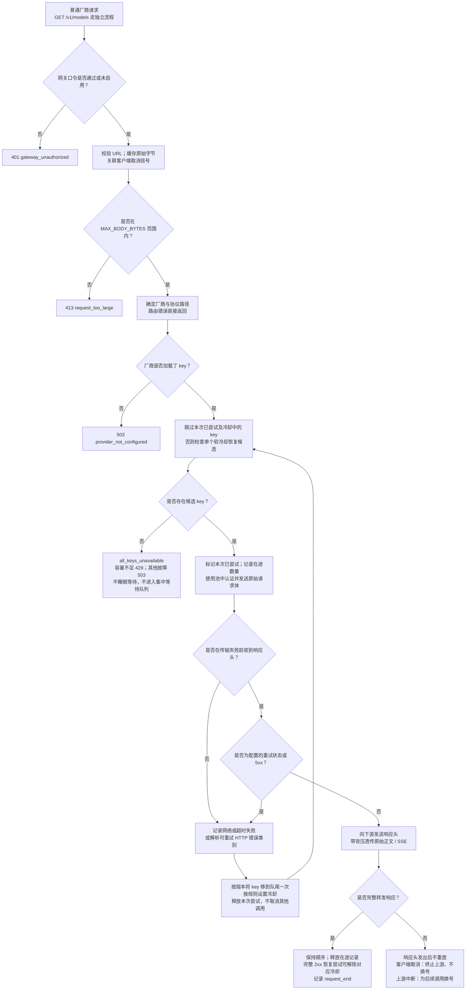
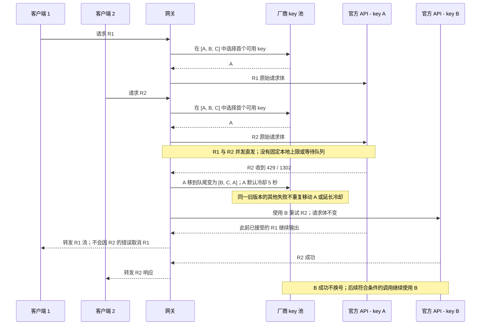
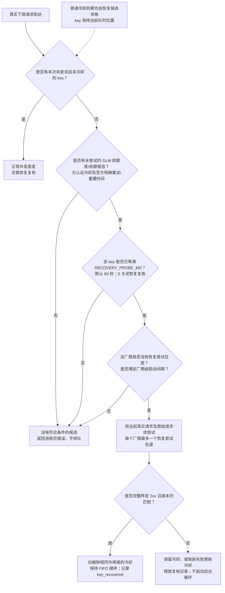
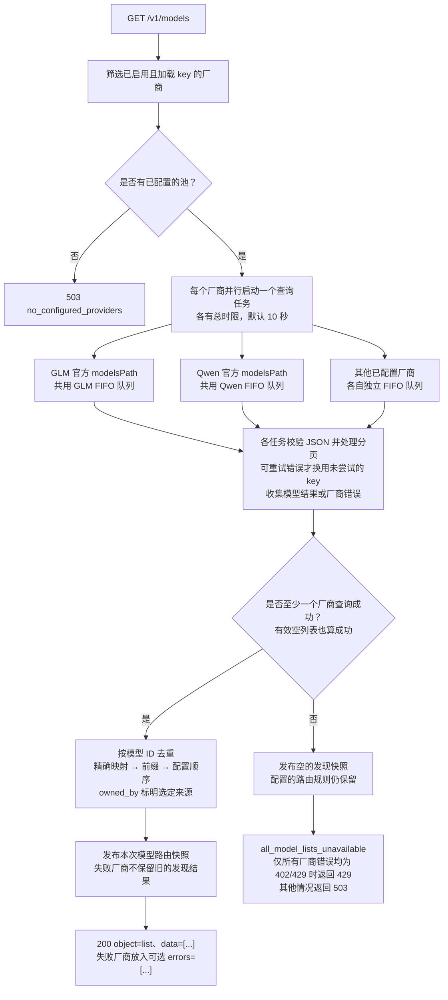
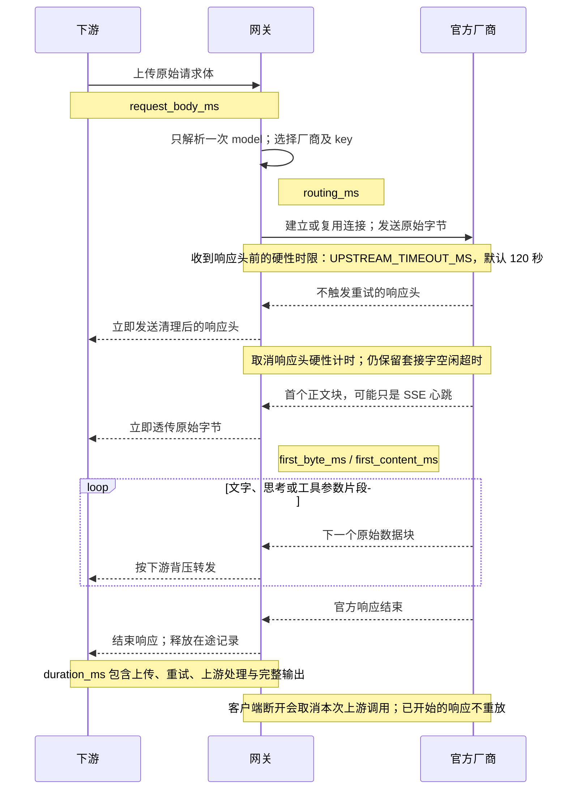
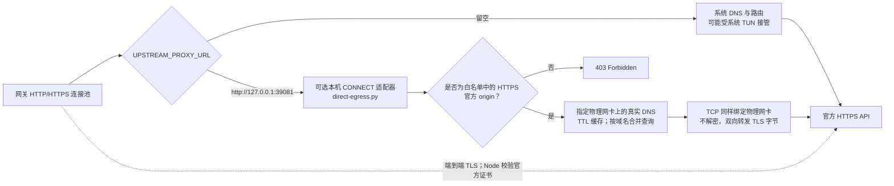

<h1 align="center">API Gateway</h1>

<p align="center">按模型路由 · 独立 key 池 · 并发流式透传</p>
<p align="center"><a href="README.md">English</a> · <strong>简体中文</strong></p>

面向官方模型 API 的轻量网关：修改基础 URL，保持官方请求格式，由每个厂商的有序 key 池处理失败切换与冷却。

## 目录

- [特性](#特性)
- [快速开始](#快速开始)
- [架构与流量全景](#架构与流量全景)
- [客户端调用](#客户端调用)
- [路由决策](#路由决策)
- [完整请求生命周期](#完整请求生命周期)
- [FIFO 与并发流量](#fifo-与并发流量)
- [重试、冷却与恢复](#重试冷却与恢复)
- [实时模型发现](#实时模型发现)
- [流式转发与超时](#流式转发与超时)
- [日志与耗时口径](#日志与耗时口径)
- [配置](#配置)
- [部署与网络访问](#部署与网络访问)
- [可选物理网卡出口](#可选物理网卡出口)
- [边界与排查](#边界与排查)
- [测试](#测试)

## 特性

- 支持 GLM、Qwen、Kimi、DeepSeek、MiniMax、OpenAI、Anthropic、Gemini、豆包和阶跃星辰的模型路由。
- 各厂商独立 FIFO key 池：持续使用首个可用 key，失败才换号，不做负载均衡或跨厂商兜底。
- 普通请求并发直发，无固定的每 key 并发上限，也无集中等待队列。
- OpenAI 与 Anthropic Messages 分别路由到官方原生接口，保留请求体、模型名、工具调用和 SSE 原始字节。
- 实时查询官方模型列表；按作用域冷却，并利用真实请求受控复核恢复。
- 仅记录元数据的 JSON 日志与连接复用。主服务只用 Node.js 内置模块，可选 Linux 出口使用 Python 3 标准库。

## 快速开始

需要 **Node.js 22.21+**；Node.js 24 请使用 **24.5+**，以支持原生代理配置。

```bash
git clone git@github.com:LMDHQ-0420/api-gateway.git
cd api-gateway
npm run init-keys
```

将 key 写入对应文件，每行一个。初始化不覆盖已有文件；忽略空行与 `#` 注释，同一池内的重复 key 自动去重。

```text
keys/
├── glm/keys.txt
├── qwen/keys.txt
├── kimi/keys.txt
└── <provider>/keys.txt
```

```bash
npm start
```

默认地址：`http://127.0.0.1:3000`。可将 `.env.example` 复制为 `.env` 设置覆盖值。缺失或空的 key 文件使对应厂商保持未配置，不影响其他厂商启动；GLM 可使用可选的旧版回退文件。修改 key 或配置后需要重启。`keys/`、`.env` 和旧版 key 文件已被 Git 忽略；自定义私有配置或 key 位置也需添加忽略规则。

## 架构与流量全景



实线表示主要请求或控制流；虚线表示配置、共享状态、元数据或辅助调用。厂商分支是候选关系：**一个普通请求只选择一个厂商**。模型发现是独立且明确并行的分支。

| 组件 | 职责 |
| --- | --- |
| [server.mjs](server.mjs) | 接入认证、请求体缓存、key 队列、传输、重试循环、流式输出与取消 |
| [routing.mjs](routing.mjs) | 校验与加载厂商、解析模型元数据、选择厂商、映射官方路径 |
| [attempts.mjs](attempts.mjs) | 在途数量跟踪与单个恢复尝试控制；普通请求不设固定并发上限、不排队 |
| [retry.mjs](retry.mjs) | 有界读取 GLM 错误、识别官方错误码、解析重置时间和 Retry-After |
| [models.mjs](models.mjs) | 并行查询官方列表、分页、去重与模型路由快照 |
| [transport.mjs](transport.mjs) | 独立 HTTP/HTTPS 复用连接池和可选显式出口 |
| [observe.mjs](observe.mjs) | 观察原始响应字节，记录首字节/内容时间，不记录正文 |
| [scripts/direct-egress.py](scripts/direct-egress.py) | 可选 Linux 物理网卡 DNS/TCP 转发，不解密 TLS、不读取 key |

## 客户端调用

OpenAI 兼容客户端将 `base_url` 设为 `http://127.0.0.1:3000/v1`，保持官方请求格式，填写实际的厂商模型 ID：

```bash
curl -N http://127.0.0.1:3000/v1/chat/completions \
  -H 'Authorization: Bearer YOUR_CLIENT_KEY' \
  -H 'Content-Type: application/json' \
  -d '{"model":"qwen-plus","messages":[{"role":"user","content":"你好"}],"stream":true}'
```

未启用 `GATEWAY_TOKEN` 时，客户端可以保留原有 key 参数；启用后通过 `Authorization: Bearer <token>` 或 Claude 兼容的 `x-api-key` 使用网关口令。上游认证始终替换为选定的官方池 key，客户端 cookie 和其他格式的认证头会被移除。透明性指请求体与原生协议行为；认证、逐跳头、聚合模型列表及网关生成的错误有各自处理规则。

| 接口 | 行为 |
| --- | --- |
| `/v1/chat/completions` | OpenAI 格式请求，按模型选择厂商 |
| `/v1/messages` | Claude Code / Anthropic 请求，映射官方 Messages 路径 |
| `/v1/messages/count_tokens` | 官方计数接口，需要所选厂商支持 |
| `GET /v1/models` | 聚合实时官方列表，见模型发现流程 |
| `/api/paas/v4/...`、`/api/coding/paas/v4/...` | 识别 GLM 官方路径 |
| `/providers/<id>/<官方路径>` | 显式选择厂商，包括不带 model 的请求 |

例如 `/providers/kimi/v1/files` 转发到 Kimi 的 `/v1/files`。专属 URL 也支持 `MAX_BODY_BYTES` 范围内的二进制或 multipart 请求体，无需自动识别模型。其他接口转发到配置的官方服务，仍需上游实际支持。

### Claude Code

基础地址使用网关根地址，**不要追加 `/v1`**：

```bash
export ANTHROPIC_BASE_URL=http://127.0.0.1:3000
export ANTHROPIC_AUTH_TOKEN=gateway
export ANTHROPIC_MODEL=glm-5.3
export ANTHROPIC_DEFAULT_OPUS_MODEL=glm-5.3
export ANTHROPIC_DEFAULT_SONNET_MODEL=glm-5.3
export ANTHROPIC_DEFAULT_HAIKU_MODEL=glm-5.3
claude
```

启用口令后，将 `gateway` 换为 `GATEWAY_TOKEN`。示例模型只是请求示例，不保证你的账号拥有权限或额度，请按账号及接口支持范围选择 ID。网关不改写 Claude 模型别名。也可将基础地址设为 `http://127.0.0.1:3000/providers/glm` 显式选择厂商。

| 厂商 | 配置的 Messages 前缀 |
| --- | --- |
| GLM | `/api/anthropic/v1` |
| Qwen | `/apps/anthropic/v1` |
| 普通 Kimi API / DeepSeek / MiniMax | `/anthropic/v1` |
| Anthropic / 阶跃星辰 | `/v1` |
| 豆包 | `/api/compatible/v1` |

这些路径来自 [providers.json](providers.json)。origin 与路径需匹配地域和套餐，订阅 key 可能需要不同地址；Kimi Code 需要单独配置对应兼容 origin 与路径。未配置 `messagesBasePath` 的厂商，例如内置 OpenAI/Gemini 项，调用 Messages 返回 `501 unsupported_protocol`。网关不做 OpenAI 与 Anthropic 正文转换；列表中的图片、音频模型也不会因此自动兼容 Claude Code。

## 路由决策



精确模型 ID 优先于已发现的 ID，其次取配置中的最长前缀；歧义匹配直接报错，不静默选择厂商。官方路径与模型归属冲突时拒绝请求，专属 URL 则明确固定厂商。查询参数与正文模型名保持原样。配置中的模型是路由规则，不会伪造成 `/v1/models` 条目，也不代表当前一定可用。

## 完整请求生命周期



1. 校验网关口令及 origin-form URL，缓存原始字节时同步执行请求体大小限制。
2. 只解析一次 JSON 模型元数据，确定厂商和协议路径，创建当前请求独有的 `seen` 集合。
3. 选择首个未尝试且可用的 key；没有正常候选时才检查受控软冷却恢复条件。
4. 替换认证后通过官方连接发送原始请求体，发送前记录尝试；普通请求不等待本地名额。
5. 可重试错误使用另一个未尝试 key；其余响应完整透传，包括不触发重试的 4xx。
6. 一旦下游响应头已发送，就停止重试；完成或取消响应、释放在途记录，写入一次最终请求日志。

网关认证、路由或配置错误直接返回。每个普通请求最多尝试所属池的每个 key 一次；重试仍可能让上游重复执行已接受的工作。不跨厂商兜底，不改写模型。

## FIFO 与并发流量



**key 队列排序的是认证凭据，不是下游请求。** 多个并发调用可以同时使用健康队首。`in_flight` 只统计本网关内的在途数量，既不限制并发，也不能据此推断官方账号上限；其他应用对共享账号的占用不可见。

| 事件 | 队列变化 |
| --- | --- |
| `[A, B, C]` 中 A 成功 | 保持 `[A, B, C]`，继续使用 A |
| A 返回可重试错误 | 变成 `[B, C, A]`；对应冷却生效时跳过 A |
| A 冷却到期 | 在当前队列位置恢复候选，不自动回到队首 |
| 另一调用报告同一旧版本的失败 | 不重复移动，也不延长较新的冷却 |
| 客户端取消 | 只取消其上游请求，不归咎或移动 key |
| Qwen 的 key 失败 | 不影响 GLM/Kimi 队列 |

配置 key 更多，不等于可用容量更多：key 可能无额度、同属一个账号，或被其他客户端占用。短请求成功、token 计数成功，都不能证明持续生成容量充足。

## 重试、冷却与恢复

### 默认错误处理

| 下游响应头发出前的情况 | 处理方式 | 默认冷却 |
| --- | --- | --- |
| `401` | 换号重试 | 5 分钟，该 key 全局生效 |
| `402` 或未分类 `429` | 换号重试 | 30 秒，按作用域隔离 |
| GLM `429 / 1302` | 换号重试 | 5 秒，按作用域隔离 |
| GLM `429 / 1308` 或 `1310` | 换号重试 | 有效官方重置时间，否则 15 分钟 |
| GLM `429 / 1113` | 换号重试 | 1 小时，按作用域隔离 |
| `403`、`408`、`5xx` | 换号重试 | 默认不新增冷却 |
| 连接失败或超时 | 换号重试 | 默认不新增冷却 |
| 其他状态，包括 `400`、`404`、`422` | 原样返回官方响应 | 不换号 |

`retryStatuses` 可按厂商自定义状态重试规则，`5xx` 仍会重试。作用域由 **协议 + 去掉查询参数的官方接口路径 + 模型** 组成；认证冷却则对该 key 全局生效。因此，同一 key 的生成、`count_tokens`、OpenAI 和模型发现可能具有不同的可选状态。

只对 GLM HTTP 429 有界读取错误体，最多 64 KiB、250 毫秒，解压后也受相同大小限制；未知、不支持或过大的错误使用通用规则。重置时间须来自 `next_flush_time`、`reset_at` 明确字段或重置提示旁的时间戳，且在未来 7 天内；GLM 中文无时区时间按 UTC+08:00 解析。官方 `Retry-After` 可延长冷却，其延长值最多 1 小时。通用/认证冷却基值设为 0 时，对应冷却规则关闭。

### 受控恢复



恢复是 **真实请求驱动，不是定时健康检查**。`RECOVERY_PROBE_MS` 默认 60 秒；每个厂商最多一个恢复尝试在途，启动间隔为 `min(15000, RECOVERY_PROBE_MS)` 毫秒，每个 key 还须满足自身间隔。不额外发送后台生成请求。仅无官方明确重试/重置时间的 GLM 额度及余额失败符合提前复核条件；`401`、短限流冷却及官方明确时间不提前复核。

只有完整转发 2xx 且失败版本仍匹配，才解除对应作用域。失败、取消、中断或非 2xx 不会恢复 key，新错误可能更新冷却。普通冷却到期独立生效。HTTP 2xx 仍不证明正文中的业务成功。

### 池耗尽

`all_keys_unavailable` 包含厂商、实际尝试次数及失败索引；可选 `cooling_keys` 包含跳过的索引、状态和剩余冷却毫秒数，不包含完整密钥。

| 普通请求的失败组合 | 网关状态 |
| --- | --- |
| 排除 `401` 后，仍至少有一个失败，且剩余状态全部为 `402`/`429` | `429` |
| 全部为 `401`，或存在其他服务器/传输失败 | `503` |

整池当前都在冷却时附带 `Retry-After`。容量不足时按非认证失败 key 的最早冷却到期时间计算，否则取最早冷却时间。没有当前符合条件的恢复尝试时直接返回，不睡眠、不排队。是否重试、何时重试由下游决定。

## 实时模型发现



每次聚合请求都会重新查询官方接口，不缓存响应、不用静态模型补充。每个厂商的总时限涵盖建连、所有 key 重试、响应体读取和分页；每页压缩前后都限制为 4 MiB，最多 100 页，支持 Anthropic 风格的 `has_more` / `last_id` 分页。

列表任务直接调用 `KeyQueue.next(..., "models")`，与生成共用队列顺序及认证冷却，**不使用 `Attempts` 的恢复复核或普通请求在途统计**。聚合全部失败时，仅所有厂商错误状态均为 402/429 才返回 429，否则返回 503；这与普通请求的混合认证失败分类是独立逻辑。

精确模型映射具有约束力：指定厂商未成功列出对应 ID 时，不从其他厂商的同名条目补位。其他情况依次取最长匹配前缀和配置顺序。成功空列表有效；去重时 ID 不区分大小写，返回时保留原始 ID。失败厂商放入 `errors` 而不是 `data`；发布新快照时，清除失败厂商旧的发现结果，配置中的精确及前缀规则仍保留。

列表查询成功只说明可以获取目录，**不说明生成有额度、接口兼容或容量充足**。厂商专属列表 URL 走普通透传流程，返回官方正文，不做聚合。

## 流式转发与超时



响应头硬性时限默认 **每次尝试 120 秒**，涵盖 DNS、建连、TLS、发送请求及不完整的响应头。收到响应头后，只保留套接字空闲超时；健康 SSE 流的总时长可以超过 120 秒。因此，多次换号可能使完整请求耗时远超单次上限。

不触发重试的响应头立即发送，原始数据块带背压透传。不关闭思考、不截短上下文或输出、不改模型、不强制流式、不并发竞速生成，也不重放已提交的响应。网关移除逐跳头与 `set-cookie`，SSE 缺少 `x-accel-buffering` 时补充 `no`；反向代理也需关闭额外缓冲。下游断开只取消当前调用；上游正文中断可能为后续调用换号，但不能安全重试当前响应。

## 日志与耗时口径

日志为标准输出的 JSON 行。普通请求依次记录 `request_start` → `route_selected` → 一次或多次 `upstream_attempt` / `upstream_response` → `request_end`。失败增加 `key_rotated`；冷却增加 `cooldown_skipped` / `pool_cooldown`；首个可识别 SSE 内容增加 `first_content`；恢复成功增加 `key_recovered`。模型发现另有厂商级结果。`runtime_config` 记录进程实际配置，包含 systemd 覆盖值。

| 字段 | 含义 |
| --- | --- |
| `request_id` | 网关生成的请求关联 ID |
| `key_index` | 启动时去重后的索引；换号时稳定，编辑文件并重启后可能改变 |
| `in_flight` | 本网关中该 key 的普通在途尝试，含完整流式响应；不含外部占用，也不是官方上限 |
| `request_bytes` / `request_body_ms` | 缓存字节数 / 接收并缓存请求体的时间 |
| `routing_ms` | 缓存完成后的 JSON 元数据解析及厂商/路径选择 |
| `upstream_response.response_headers_ms` | 当前这一次尝试的响应头等待时间 |
| `request_end.response_headers_ms` | 到最终转发响应头的总时间，含上传、路由和换号重试 |
| `first_byte_ms` | 首个响应体字节，可能只是心跳而非内容 |
| `first_content_ms` / `first_content_kind` | 首个可识别、未压缩 SSE 的文字、思考或工具片段，不一定是答案文字 |
| `response_bytes` / `duration_ms` | 转发的正文字节数 / 整个请求耗时 |
| `transport.request_sent_ms` | 本次尝试到 Node 完成写出请求的时间，不代表远端已处理 |
| `transport.wait_after_upload_ms` | 响应头时间减去本地写出完成时间，仍含网络及官方等待 |
| 传输错误 `phase` | `upload_or_connection` 或 `waiting_headers`，不是对具体原因的精确诊断 |

最终结果分为 `success`、`http_error`、`partial_success`（聚合列表）、`client_disconnected` 和 `upstream_interrupted`。成功指 HTTP 完整转发，不保证正文业务成功。压缩或非 SSE 响应不提供内容计时。汇总耗时时，生成、`count_tokens` 和模型列表应分开，并说明窗口、成功率分母及未结束请求；快速失败会拉低均值，却不代表容量改善。

只记录元数据：不记录 key、认证或其他请求头、提示词、响应正文和查询参数。未知路径段替换为 `:redacted`，日志模型名最多 200 字符，请勿在模型名中放秘密。使用用户级 systemd 部署时：

```bash
journalctl --user -u api-gateway.service -f -o cat
```

`npm start` 查看终端，Docker 使用 `docker logs -f api-gateway`；保留策略由 journal 或容器日志配置管理。

## 配置

将 [.env.example](.env.example) 复制为 `.env`。下表为默认值，服务管理器的环境变量可能覆盖它们。

| 变量 | 默认值 / 用途 |
| --- | --- |
| `HOST` / `PORT` | `127.0.0.1` / `3000` |
| `PROVIDERS_FILE` | `providers.json` |
| `GATEWAY_TOKEN` | 空，可选客户端访问口令 |
| `KEYS_FILE` | `keys.txt`，GLM 专属池为空时的旧版回退 |
| `UPSTREAM_ORIGIN` | 未设置，可选 GLM origin 覆盖值 |
| `UPSTREAM_TIMEOUT_MS` | `120000`，每次尝试的响应头时限，之后为套接字空闲超时 |
| `UPSTREAM_KEEPALIVE_MS` | `60000`，空闲连接复用，尊重官方更短的提示 |
| `UPSTREAM_PROXY_URL` | 空，使用系统路由，不继承其他应用的代理环境 |
| `MODELS_TIMEOUT_MS` | `10000`，每个厂商完成模型发现的总时限 |
| `MAX_BODY_BYTES` | `33554432`，即 32 MiB |
| `KEY_COOLDOWN_MS` / `AUTH_COOLDOWN_MS` | `30000` / `300000`，`0` 关闭对应冷却规则 |
| `RATE_COOLDOWN_MS` / `QUOTA_COOLDOWN_MS` / `BALANCE_COOLDOWN_MS` | `5000` / `900000` / `3600000`，GLM 分级默认值 |
| `RECOVERY_PROBE_MS` | `60000`，`0` 关闭提前软冷却恢复 |

厂商定义在 [providers.json](providers.json)，`keysFile` 相对该配置文件解析。配置 `id`、`origin`、`basePath`、`models`、`modelPrefixes`，以及可选的 `messagesBasePath`、`messagesAuth`、`modelsPath`、`nativePrefixes`、`auth`、`headers`、`retryStatuses`、`enabled`。`models` 用于精确路由，包括 `ep-...` 等接入点 ID，不填充实时模型目录。新增厂商后运行 `npm run init-keys` 初始化文件；私有地址覆盖值可放在单独忽略的配置中，并由 `PROVIDERS_FILE` 指向。

## 部署与网络访问

`npm start` 会加载 `.env`；持久运行请使用 systemd、Docker 等进程管理方式。内网访问需监听可达网卡，例如设置 `HOST=0.0.0.0`，客户端填写服务端内网地址；主机防火墙及 WSL/Windows 端口转发也需放行，单独修改 `HOST` 不会自动建立转发。示例 3000 是项目默认端口，不保证与你部署中的实际端口相同。

### Linux systemd

先执行 `mkdir -p ~/.config/systemd/user`，再创建 `~/.config/systemd/user/api-gateway.service`，将 `/absolute/path/api-gateway` 和 `/usr/bin/node` 换为实际安装路径：

```ini
[Unit]
Description=API Gateway

[Service]
WorkingDirectory=/absolute/path/api-gateway
ExecStart=/usr/bin/node --env-file-if-exists=.env /absolute/path/api-gateway/server.mjs
Restart=always
RestartSec=5
TimeoutStopSec=15
UMask=0077

[Install]
WantedBy=default.target
```

```bash
systemctl --user daemon-reload
systemctl --user enable --now api-gateway.service
```

如需退出登录后仍运行，可在有权限时执行 `loginctl enable-linger "$USER"`。后续修改 key 或配置，用 `systemctl --user restart api-gateway.service` 生效；重启会清空内存状态，且可能中断长调用。

### Docker

先准备本地 key 文件：

```bash
docker build -t api-gateway .
docker run -d --name api-gateway --restart unless-stopped \
  -p 127.0.0.1:3000:3000 \
  --mount type=bind,src="$PWD/keys",dst=/app/keys,readonly \
  --mount type=bind,src="$PWD/providers.json",dst=/app/providers.json,readonly \
  api-gateway
```

镜像不包含 key 与 `.env`。挂载文件需允许容器用户读取，必要时用 `--user "$(id -u):$(id -g)"`。内网发布时，将宿主机绑定地址从 `127.0.0.1` 改为所需地址；使用 `--env-file .env` 时，容器内保持 `HOST=0.0.0.0`。反向代理需支持实时流式转发；浏览器使用还需同源访问或自行配置 CORS。

## 可选物理网卡出口



可选 Linux 适配器适用于系统路由或 TUN 干扰官方直连的部署；系统路由正常的网络不需要启用。

```bash
python3 scripts/direct-egress.py \
  --interface <物理网卡> \
  --dns-server <网络DNS服务器> \
  --providers-file providers.json
```

设置 `UPSTREAM_PROXY_URL=http://127.0.0.1:39081` 后重启网关。适配器仅监听本机，读取配置的 HTTPS origin，不读 key 文件。DNS 按 TTL 缓存并按域名合并查询；TCP 绑定相同网卡，连接积压量采用系统值应对突发建连。TLS 保持端到端，仍由 Node 校验证书。Linux 需允许 `SO_BINDTODEVICE`，仅支持 IPv4；网卡或 DNS 变化需更新参数。容器需使用可达的适配器地址，而非容器自身回环地址；标准 Node 镜像未包含 Python 或此可选脚本。出口留空时不使用本机转发器，但仍可能受系统级 TUN 路由影响。

## 边界与排查

| 现象 / 边界 | 解释 |
| --- | --- |
| 短测成功，生产仍出现 429 | 瞬时成功不代表持续额度或并发容量，需看错误类别及账号外部占用 |
| 模型列表或 `count_tokens` 成功，生成失败 | 接口及作用域不同，目录或计数权限不代表生成容量 |
| 首个片段很快，完整结束很慢 | 完整耗时还包含官方思考、工具及正文生成、重试和下游背压 |
| 首字节很快但没有 `first_content_ms` | 可能只是心跳、压缩数据、非 SSE，或无法识别/无内容的流 |
| `all_keys_unavailable` | 未尝试候选均在冷却或已失败，恢复机会可能未到或已被占用 |
| 模型与官方路径冲突 | 修正精确/前缀配置，或使用 `/providers/<id>` |
| 启动多个网关进程 | 各有自己的 FIFO、冷却与恢复状态，不提供分布式协调 |
| 重启 | 重新加载 key 和规则；内存顺序、冷却、发现模型及在途记录重置，长调用可能中断 |
| 上传及账号资源 | 在大小限制内缓存请求体，文件/任务不绑定最初使用的 key |
| 已提交的响应 | 下游响应头发出后不能安全重放，HTTP 200 中的业务/SSE 错误保持透传 |
| 支持的传输 | HTTP/SSE，不支持 WebSocket 或协议转换 |

需要统一队列顺序时运行单实例。同账号下增加 key 不一定提高限制；本网关负责路由，不创造额外官方额度，也不保证上游可用性。

## 测试

```bash
npm test
```

测试使用本地模拟厂商，不需要真实 key 或付费生成。可选 Linux 出口测试需要 Python 3；TLS 测试在 OpenSSL 可用时生成临时证书。上述 Mermaid 图可直接在 GitHub 渲染。
